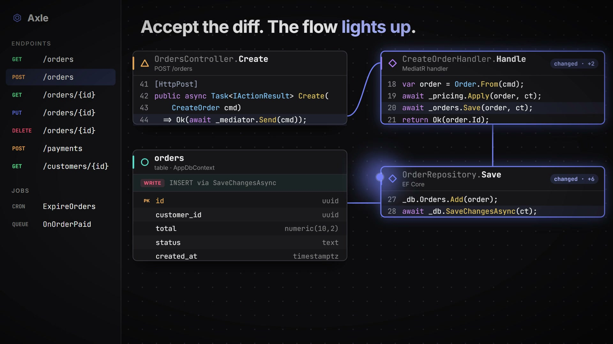
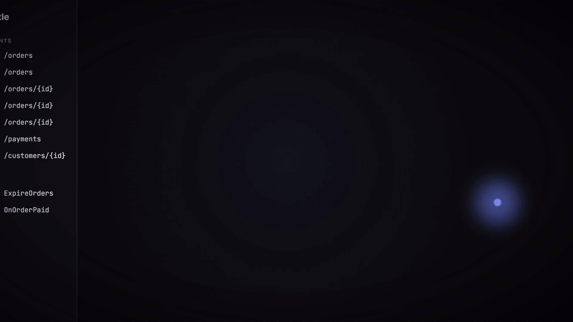

<p align="center">
  
</p>

<h1 align="center">Axle</h1>

<p align="center">
  <b>A harness-first code editor.</b><br>
  Built around how code <b>runs</b>, and around the agents that change it.
</p>

<p align="center">
  <a href="LICENSE"></a>
  <a href="https://github.com/bothuany/axle/releases"></a>
  
  
</p>

<p align="center">
  <a href="#install-windows">Install</a> ·
  <a href="#getting-started">Build from source</a> ·
  <a href="#languages">Languages</a> ·
  <a href="#agent-tools-mcp">Agent tools</a> ·
  <a href="CONTRIBUTING.md">Contributing</a>
</p>

<!-- For inline playback on GitHub, drag docs/media/axle-demo.mp4 into this README in GitHub's editor and replace this block with the user-attachments URL it gives you. -->
<p align="center">
  <a href="docs/media/axle-demo.mp4">
    
  </a>
  <br>
  <sub>▶ <a href="docs/media/axle-demo.mp4">Watch the 28-second demo</a> (with sound)</sub>
</p>

Axle is VS Code with a small set of core patches and four built-in extensions, in a native window. Every editor shows where code is stored; Axle shows how it runs.

### See the chain a request runs

Pick an endpoint, or put the cursor in any method, and see the chain it runs: controller → handler → services → database, each step as an editable card with its real code. Database cards show the table schema the query touches.

<p align="center">
  
</p>

### Agents in real terminals

Claude Code and Codex run as their real CLIs in terminals. An Agents dock shows each one's state at a glance (working, needs you, done), its prompt, its current step, its to-dos and how full its context is. Whatever needs you rises to the top. Closed sessions resume where they stopped. You can add any other agent CLI.

### Claude Code `/ide`, on the canvas

`claude` in an Axle terminal connects automatically: its diffs open in Axle with Accept and Reject, and the methods they touch light up on the canvas. When a turn ends, the Agents dock lists the flows it touched.

### Harness engineering, built in

A map and health score of your `CLAUDE.md`, skills, hooks and permissions; a hook studio that runs a hook with a realistic payload; a permission inbox that turns an answer into a standing rule; a context-budget meter.

## Languages

| | Axle from an endpoint | Axle at the cursor | Database schema cards |
|---|---|---|---|
| C# / .NET | ✓ ASP.NET (Roslyn, incl. MediatR and DI); needs the .NET 10 SDK | ✓ | ✓ EF Core |
| Java | ✓ Spring, JAX-RS, Servlets, Axis2, JSF, plus scheduled jobs and message listeners | ✓ | in progress: JPA, JDBC |
| Python | ✓ FastAPI, Flask, Django / DRF | ✓ | ✓ Django ORM (SQLAlchemy untested) |
| JavaScript / TypeScript | ✓ Express, NestJS, Next.js (app and pages routers) | ✓ | Prisma and TypeORM (untested) |
| Go | ✓ Gin, Echo, Fiber, chi, net/http | ✓ | not yet |
| PHP | ✓ Laravel routes and resources, Symfony `#[Route]` | ✓ | not yet |
| Ruby | ✓ Rails routes, `resources`, Sinatra | ✓ | not yet |
| Rust | ✓ axum, actix-web, Rocket | ✓ | not yet |
| Kotlin, Swift and others | not yet | only if you install that language's extension (Open VSX) and its server supports call hierarchy; not tested here | not yet |

**How it resolves a flow.** Entry points (routes, jobs, listeners) and most calls come from a build-free tree-sitter index, so a project opens instantly and needs no restore or compile. Calls the index cannot resolve, or only guessed by name, are asked to the language server of that file (go-to-definition, then go-to-implementation for interface methods) when one is running; no server, or no answer within 1.5 s, leaves the flow as the index drew it. Turn it off with `flow.lspResolution`. C# uses the Roslyn analyzer in `analyzer/` (it needs the project restored, and the .NET 10 SDK to run). Go, PHP, Ruby and Rust were checked on small sample projects only; the linking is name-based within a package or directory, so large codebases lean on their language server for the rest.

## Install (Windows)

Download `Axle-Setup-<version>-x64.exe` from the [Releases](https://github.com/bothuany/axle/releases) page and run it. That is all: Axle ships with everything it needs, so no Node, git or build tools are required. It installs for the current user (no admin rights) into `%LOCALAPPDATA%\Programs\Axle`, adds a Start menu entry and, if you leave the options ticked, the `axle` command on your PATH and "Open with Axle" on folders in Explorer. Your data lives in `~/.axle`. Updating means running a newer Setup over the old install; uninstalling is Windows Settings, Apps.

- **C# flows need the .NET 10 SDK on the PC** ([download](https://dotnet.microsoft.com/download/dotnet/10.0)). Axle's C# analyzer is a .NET 10 program that loads your solution with MSBuild, so the runtime alone is not enough. Without the SDK everything else works; the first time a C# flow is asked for, Axle shows one notice that says so. Other languages need nothing.
- Install into a short path (the default, `%LOCALAPPDATA%\Programs\Axle`, is fine). The longest file in Axle is about 155 characters below the install folder, and Windows stops at 260 in total, so an install folder that is itself 100 characters deep fails with "MoveFile failed; code 3".
- The installer is not code-signed yet, so Windows SmartScreen shows "Windows protected your PC" the first time: choose *More info*, then *Run anyway*.
- Axle is installed beside, not over, a stock VS Code or Code - OSS: it has its own app id, install folder, `axle://` link scheme and data folder.

**Build the installer yourself** (Windows, after `npm run setup`, plus the .NET 10 SDK and the Windows SDK, whose `signtool.exe` VS Code's build calls):

```bash
npm run installer                   # dist/Axle-Setup-<version>-x64.exe, per user
npm run installer -- --system       # also dist/Axle-Setup-<version>-x64-system.exe (all users, asks for admin rights)
npm run installer -- --fast         # reuse editor/VSCode-win32-x64 when VS Code, the core patch, product.json and the icon are unchanged since the last full build (dist/app-build.stamp says so): only Axle's own parts and Inno Setup run again, minutes instead of half an hour
npm run installer -- --full         # the full build whatever the stamp says (the default)
```

It builds the extensions, the canvas and the analyzer, runs VS Code's production build (15 to 40 minutes, several GB of RAM, about 20 GB of disk) and its Inno Setup step, and prints where the installer is. Pushing a `v*` tag builds and attaches it to a GitHub release (`.github/workflows/release.yml`).

## Requirements

| | macOS | Windows | Linux |
|---|---|---|---|
| Node 24.x (24.18 or newer; 25 will not do) and git | required | required | required |
| .NET 10 SDK, for C# flows | optional | optional | optional |
| Build tools for VS Code's native modules | Xcode Command Line Tools | Python 3 + Visual Studio Build Tools ("Desktop development with C++" plus its "MSVC Spectre-mitigated libs"; with Visual Studio 2026 also set `vs2022_install` to its folder and use npm 11.6+ / node-gyp 12+) | `build-essential`, `libx11-dev`, `libxkbfile-dev`, `libsecret-1-dev` |

`npm start` opens Axle in its own window (Electron, like any VS Code fork). `npm run web` serves the same editor to a browser instead. On Windows, `npm run shortcut` adds a Desktop and Start menu shortcut; it points at the Node that ran it, so run it again after you switch Node versions (nvm, fnm).

## Getting started

```bash
git clone https://github.com/bothuany/axle.git
cd axle
npm run setup
npm start
```

`npm run setup` clones VS Code 1.141.0 into `editor/vscode`, applies `editor/patches`, links the Axle extensions into it, and builds everything. The first run takes 10–20 minutes, mostly VS Code's `npm ci`. Running it again skips the clone, the patches, the links and (when nothing changed) `npm ci`; `--force-install` runs that anyway. If `editor/vscode` is at another VS Code version, or the patches do not apply to it, setup stops and says to delete it and run again. Steps that are optional (Electron's pre-launch, the server's Node, the app icon stamp, the C# analyzer) only warn when they fail, and the summary at the end lists them.

```bash
npm start -- path/to/project     # Axle window, opening a folder
npm run web -- path/to/project   # same editor, served for a browser
```

A folder is resolved from the directory you ran the command in. `npm run web` prints the URL to open, and it carries a random `?tkn=` token (new on every start) that the server requires: open that URL, not `http://127.0.0.1:8765` alone. The port is 8765, or `FLOW_PORT` when set (`FLOW_PORT=9000 npm run web`). The server listens on 127.0.0.1 only. It reads the token from a private temporary file instead of its command line, and it starts with `--accept-server-license-terms`, so running it accepts the VS Code server terms for you.

**Web mode is for your own code only.** The core patch (`webviewEndpoint` in `webClientServer.ts`) serves webviews from the same origin as the workbench, so that they work offline. A browser then no longer isolates a webview from the editor: do not open untrusted folders or install untrusted extensions in `npm run web`. The Electron window (`npm start`) is not affected.

**Your data folder is `~/.axle`.** Axle's `product.json` sets `dataFolderName` to `.axle`, so it does not share `~/.vscode-oss` with a stock Code - OSS build. Anything you already have in `~/.vscode-oss` (extensions you installed, state) is not migrated; copy what you want over by hand.

## Layout

```
editor/patches/     core patches to VS Code (branding, theme hooks, chat defaults, webview fixes)
editor/branding/    the app icon (.ico, .icns, .png), drawn by scripts/make-icons.py (needs Pillow)
editor/extensions/
  flow-view/        canvas host, endpoints list, Roslyn + polyglot providers, Claude Code /ide bridge
  flow-agent/       terminal agents and the Agents dock (plus ACP chat sessions, off by default)
  flow-harness/     harness map, hook studio, permission inbox, context budget
  flow-theme/       Axle's colour theme and defaults
ui/                 the canvas (React Flow + Monaco), built into one script the extension inlines
analyzer/           C# analyzer (.NET 10, Roslyn MSBuildWorkspace) serving flows over HTTP
scripts/            setup, start, build-extensions, install-shortcut and installer (Windows .exe), the same on every OS (lib.mjs starts programs without a shell)
```

## Developing

- Extensions: edit under `editor/extensions`, then `npm run build:extensions` and reload the window (`Developer: Reload Window`).
- Canvas: `npm run build:canvas`, then reload the window.
- Core patches: change files in `editor/vscode`, then regenerate the patch from there. New files must be known to git first, and the icons that `setup` copies into `resources/` must stay out of the patch:
  `git add -N src product.json && git diff HEAD -- build src product.json > ../patches/flow-core.patch`. Run it in Git Bash (or any POSIX shell): Windows PowerShell 5.1 writes `>` output as UTF-16, which breaks the patch.
- Tests: `cd editor/extensions/flow-view && npm test` builds the index worker and checks what it finds in every project under `test/fixtures` against `test/expected` (after an intended change: `UPDATE=1 npm test`, then read the diff). `npm run typecheck` there checks the types.

## Agent tools (MCP)

Claude Code over `/ide` only shows its model the `getDiagnostics` tool, so Axle ships its own small MCP server, `axle`, that lets an agent work with the editor. All tools are read, display or open only: they write no files and run no commands, and paths must lie inside an open workspace folder.

| Tool | What it does |
|---|---|
| `open` | Opens a file at a line or range, without taking focus |
| `find_entry_points` | Free-text search over endpoints and jobs ("delete user" finds `DELETE /users/{id}`) |
| `show_flow`, `flow_text` | Opens the flow canvas, or returns the call chain as compact text (files, call lines, tables touched) |
| `impact` | Who calls a method, and which entry points reach it |
| `get_context` | Active file, selection, flow on the canvas, open tabs, git changes, diagnostics, boards |
| `draw_board`, `update_board` | The agent draws a flow, plan, class, ER or architecture board, and ticks its steps off as it works |

- **Agents started from the Agents dock** get the server automatically (`flow.agents.mcp`, on by default; it adds `--mcp-config` and keeps your own MCP servers).
- **A `claude` you start yourself** gets it after the command **Axle: Connect Claude Code Tools (MCP)**. It shows the exact `claude mcp add` it will run and changes your Claude Code user configuration only when you confirm; **Disconnect** removes it.
- Each Axle window lists itself in `~/.axle/bridge/<pid>.json` (loopback port and token); the server picks the window whose workspace folder contains its working directory.
- In plan mode, the plan an agent submits is drawn as a board (`flow.agents.planBoard`), its steps move to doing and done as files are edited, and when a turn ends the Agents dock lists the flows it touched (`flow.agents.turnImpact`). Boards open as a Markdown preview with a Mermaid diagram; **Axle: Show Board…** lists them.

## How agent status works

Axle starts `claude` with `--settings <file>` that adds observe-only hooks on top of your own settings (your hooks still run). Each hook runs a small Node script that posts the event to the Axle window. The hooks never answer a permission question: Claude Code keeps asking you itself. Codex and custom agents are listed without status.

## Contributing

Bug reports, fixes and new language support are welcome: see [CONTRIBUTING.md](CONTRIBUTING.md). Report security problems privately, as [SECURITY.md](SECURITY.md) describes.

## License

MIT. Axle builds on [VS Code](https://github.com/microsoft/vscode) (MIT); the Claude and Codex marks in the Agents dock belong to their owners.
