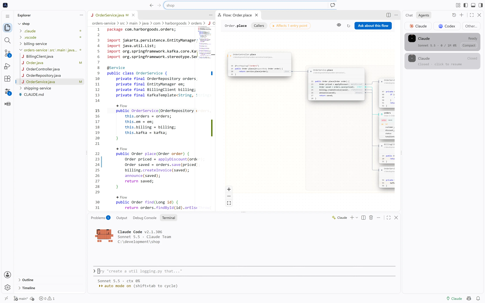
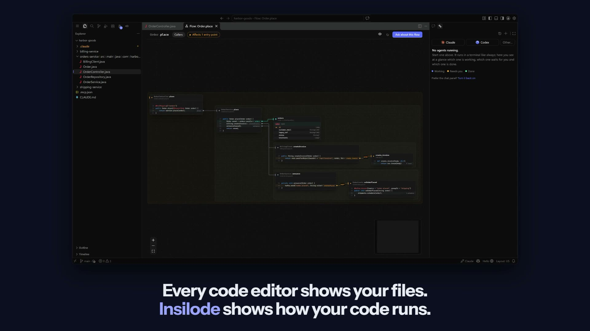

  

<h1 align="center">Insilode™</h1>

  <b>The code editor that shows how your code runs.</b> 
  Built on VS Code, so your extensions, themes and keybindings work. Plus a live canvas of every request, a review of what your agents changed, and a dock that runs Claude Code and Codex side by side.

  
  
  

<b><a href="https://insilode.dev/try/">Try it in your browser</a></b>: follow a request across services, review what an agent changed, and answer an agent waiting for you. Nothing to install.

## Coming from VS Code

Insilode is a fork of VS Code (Code - OSS, the open-source core of VS Code), so the editor you know is all there: Git, the terminal, the debugger, language servers, IntelliSense, search, tasks, multi-root workspaces, profiles. Insilode adds to it.

- **Extensions** install from [Open VSX](https://open-vsx.org/), the open registry VS Code forks use. A few of Microsoft's own extensions (Pylance, C# Dev Kit, the Remote - SSH / WSL / Dev Containers family, GitHub Copilot) are licensed for Microsoft's builds only and are not there; open alternatives are.
- **Themes, keybindings and settings** work the same: the same commands, shortcuts and `settings.json`.
- **Bring your setup:** in VS Code, run **Profiles: Export Profile…** to save your settings, keybindings, snippets and extension list to a file; in Insilode, choose **Import Profile…** in **Preferences: Open Profiles (UI)**.
<!-- TODO(import-from-vscode): the one-click "Import from VS Code" is in PR #28, not released. When it ships, replace the line above with: "Import your settings, keybindings, snippets and theme from VS Code or Cursor; extensions available on Open VSX are installed, the rest are listed." Never "all your extensions". Same in site/index.html and docs/design/messaging.md. -->

## See how your code runs

Pick an endpoint and watch the chain it runs, card by card: controller → handler → services → database, each with its real, editable code. Database cards show the table the query touches. The flow follows calls across services too: an HTTP call continues into the route it reaches, a message continues into the listener of its topic or queue (Kafka, RabbitMQ, JMS, SQS, Celery, NestJS). Links found by matching names or paths are drawn dashed as guesses (`HTTP?`, `topic?`), so you always know what is certain.

## Review what an agent changed, on the flow

Ask the agent to "show what you did in flow", or run **Show Git Changes in Flow**. One canvas holds the whole change set: every endpoint the changed code reaches, cut down to the changed methods, added lines in green and removed lines in red. Compare against your uncommitted work, the whole branch since `main`, or the last commit. After each prompt, the Agents dock lists the flows that turn touched.

## Run agents side by side, and know when they need you

Claude Code, Codex and any CLI you add run as their real tools, in terminals. The Agents dock shows each one at a glance and ranks what needs you first: an approval with its text, a question, an error, a finished turn you have not read. Each row carries the model and how full its context window really is, tokens and estimated cost, and the PR and CI state of its branch. Start an agent in its own git worktree, merge it back with one click, and get warned when two agents edit the same file, method or flow. Questions from Home or the canvas go to the agent you pick, and Insilode remembers the choice. The status bar shows what is left of your 5-hour and weekly limits.

Outside the editor, an optional app badge counts the agents waiting for you, and an optional status island at the top of the screen (or any corner) shows every agent's state at a glance with an avatar per agent, on macOS and Windows. It never takes focus.

## Keep your harness healthy

One map of what shapes your agents: `CLAUDE.md` and `AGENTS.md`, rules, skills, subagents, hooks, MCP servers, permissions and the agents' own memory, with a health score and what each piece costs in tokens before you type.

- **Lint without an LLM:** rules whose paths match nothing, broken frontmatter, duplicated instructions across tools, hooks that never fire.
- **Context X-ray:** what fills a running agent's window, and what you could drop.
- **What actually runs:** which hooks, skills, subagents and MCP tools fired, and which have not been used in a month.
- **Why?:** the instructions, rules and permissions that apply to a file, and a simulator that tells you whether `Bash(git push --force)` would be allowed, asked or denied, and by which rule.
- **Friction inbox:** permissions you keep granting, corrections you keep repeating and tool calls that keep failing become proposed rules, instructions and hooks, applied only when you say so.
- **MCP servers:** see, check, add, edit and remove the servers of Claude Code and Codex, with secrets kept out of view.

## Works with your stack

C# / .NET · Java · Python · JavaScript / TypeScript · Go · PHP · Ruby · Rust, from ASP.NET and Spring to FastAPI, NestJS, Rails and axum. [Full support table →](docs/languages.md) · Agent tools and the `insilode` MCP server: [docs/agent-tools.md](docs/agent-tools.md)

## Updates

A running Insilode checks the latest GitHub release and shows **Update available** (on the gear and under Help, Check for Updates). On Windows it downloads and installs the update and offers **Restart to Update**; on macOS and Linux the notification's button opens the release page. Set `update.mode` to `manual` or `none` to turn the automatic check down or off. [How it works →](packaging/README.md#updates)

## Contributing

Issues and pull requests are welcome: see [CONTRIBUTING.md](CONTRIBUTING.md). Report security problems privately ([SECURITY.md](SECURITY.md)).

Open source under the [GNU AGPL v3](LICENSE) (versions before 0.5.0: MIT); contributors sign a short [CLA](CLA.md). Insilode™ and its logo are trademarks of Recep Batuhan Dikmen; see the [trademark policy](TRADEMARKS.md). Insilode is built on [VS Code](https://github.com/microsoft/vscode) (Code - OSS) and is not affiliated with Microsoft; the Claude and Codex marks belong to their owners.
