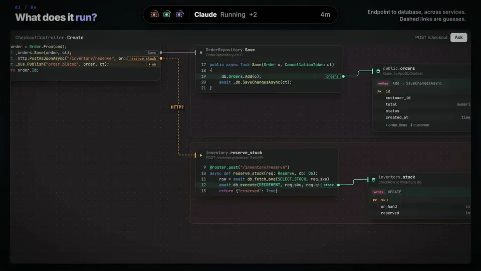

  

<h1 align="center">Axle</h1>

  <b>A harness-first code editor.</b> 
  Every editor shows where code is stored. Axle shows how it <b>runs</b>.

  
  
  

  

https://github.com/user-attachments/assets/ea31fc6d-1561-4d4f-a5cd-fa33b7163ba6

## See how your code runs

Pick an endpoint and watch the chain it runs, card by card: controller → handler → services → database, each with its real, editable code. Database cards show the table the query touches.

## Let agents work, and know when they need you

Claude Code and Codex run as their real CLIs. The Agents dock shows each one at a glance (working, needs you, done) and whatever needs you rises to the top. When Claude proposes a change, the diff opens in Axle and the methods it touches light up on the canvas.

## Keep your harness healthy

A map and health score of your `CLAUDE.md`, skills, hooks and permissions. Broken hooks and vague skills surface before they cost you a session, and one click turns a permission you keep granting into a standing rule.

## Works with your stack

C# / .NET · Java · Python · JavaScript / TypeScript · Go · PHP · Ruby · Rust, from ASP.NET and Spring to FastAPI, NestJS, Rails and axum. [Full support table →](docs/languages.md)

## Contributing

Issues and pull requests are welcome: see [CONTRIBUTING.md](CONTRIBUTING.md). Report security problems privately ([SECURITY.md](SECURITY.md)).

MIT licensed. Axle builds on [VS Code](https://github.com/microsoft/vscode); the Claude and Codex marks belong to their owners.
