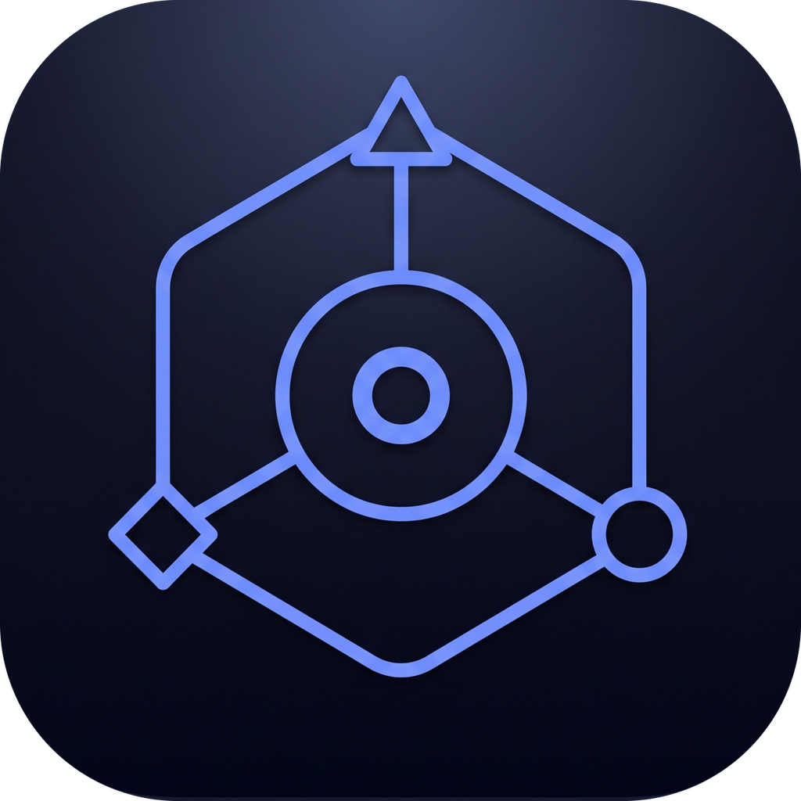

  

<h1 align="center">Axle</h1>

  <b>A harness-first code editor.</b> 
  Every editor shows where code is stored. Axle shows how it <b>runs</b>.

  
  
  

<b><a href="https://bothuany.github.io/axle/">Try it in your browser</a></b>: start an agent and watch the dock, the notch overlay, the terminal and the flow canvas follow it. Nothing to install.

https://github.com/user-attachments/assets/2659c972-8d4a-40d3-bbe0-6f4442d24aa5

## See how your code runs

Pick an endpoint and watch the chain it runs, card by card: controller → handler → services → database, each with its real, editable code. Database cards show the table the query touches. The flow follows calls across services too: an HTTP call continues into the route it reaches, a message continues into the listener of its topic or queue (Kafka, RabbitMQ, JMS, SQS, Celery, NestJS). Links found by matching names or paths are drawn dashed as guesses (`HTTP?`, `topic?`), so you always know what is certain.

## Review what an agent changed, on the flow

Ask the agent to "show what you did in flow", or run **Show Git Changes in Flow**. One canvas holds the whole change set: every endpoint the changed code reaches, cut down to the changed methods, added lines in green and removed lines in red. Compare against your uncommitted work, the whole branch since `main`, or the last commit. After each prompt, the Agents dock lists the flows that turn touched.

## Run agents side by side, and know when they need you

Claude Code, Codex and any CLI you add run as their real tools, in terminals. The Agents dock shows each one at a glance and ranks what needs you first: an approval with its text, a question, an error, a finished turn you have not read. Each row carries the model and how full its context window really is, tokens and estimated cost, and the PR and CI state of its branch. Start an agent in its own git worktree, merge it back with one click, and get warned when two agents edit the same file, method or flow. Questions from Home or the canvas go to the agent you pick, and Axle remembers the choice. The status bar shows what is left of your 5-hour and weekly limits.

Outside the editor, an optional app badge counts the agents waiting for you, and an optional status island at the top of the screen (or any corner) shows every agent's state at a glance with an avatar per agent, on macOS and Windows. It never takes focus.

## Keep your harness healthy

One map of what shapes your agents: `CLAUDE.md` and `AGENTS.md`, rules, skills, subagents, hooks, MCP servers, permissions and the agents' own memory, with a health score and what each piece costs in tokens before you type.

- **Lint without an LLM:** rules whose paths match nothing, broken frontmatter, duplicated instructions across tools, hooks that never fire.
- **Context X-ray:** what fills a running agent's window, and what you could drop.
- **What actually runs:** which hooks, skills, subagents and MCP tools fired, and which have not been used in a month.
- **Why?:** the instructions, rules and permissions that apply to a file, and a simulator that tells you whether `Bash(git push --force)` would be allowed, asked or denied, and by which rule.
- **Friction inbox:** permissions you keep granting, corrections you keep repeating and tool calls that keep failing become proposed rules, instructions and hooks, applied only when you say so.
- **MCP servers:** see, check, add, edit and remove the servers of Claude Code and Codex, with secrets kept out of view.

## Works with your stack

C# / .NET · Java · Python · JavaScript / TypeScript · Go · PHP · Ruby · Rust, from ASP.NET and Spring to FastAPI, NestJS, Rails and axum. [Full support table →](docs/languages.md) · Agent tools and the `axle` MCP server: [docs/agent-tools.md](docs/agent-tools.md)

## Contributing

Issues and pull requests are welcome: see [CONTRIBUTING.md](CONTRIBUTING.md). Report security problems privately ([SECURITY.md](SECURITY.md)).

MIT licensed; contributors sign a short [CLA](CLA.md). The Axle name and logo have their own [policy](TRADEMARKS.md). Axle builds on [VS Code](https://github.com/microsoft/vscode); the Claude and Codex marks belong to their owners.
